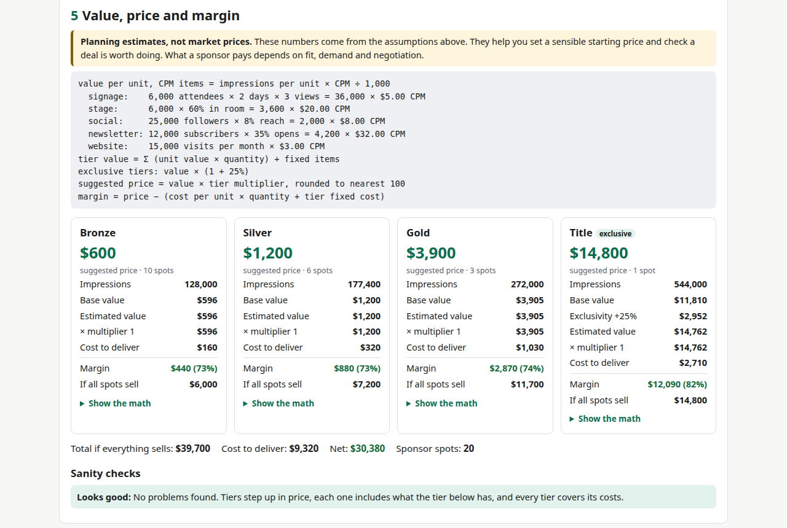

# Sponsorship package builder

Build event sponsorship tiers, price them with a formula you can actually read, and print a one-page sponsor sheet.

**Live:** https://mizoz.github.io/sponsorship-builder/



I built this because pricing sponsorships usually goes like this: someone finds an old PDF from another event, changes the logo, and hopes $5,000 sounds right for Gold. I wanted something that shows what a sponsor is actually getting (how many people see the sign, open the email, hear the mention) and whether a tier even covers what it costs to deliver.

## What it does

- Event basics: attendance, days, audience, email list, social followers, site visits, ticket price
- A deliverables list you can edit: signage, stage mentions, social posts, newsletter features, website logo, tickets, booth, sampling, speaking slot, naming rights, plus anything you add
- Tick deliverables into Bronze / Silver / Gold / Title (rename them, add or remove tiers), with quantities, spots per tier, a price multiplier and a fixed cost
- Value per tier = impressions × CPM by channel, plus fixed-value items. The full formula is on the page with your numbers in it
- Suggested price, cost to deliver, margin, and what you make if every spot sells
- Category exclusivity premium and exclusive-only deliverables
- Sanity checks: tiers out of order, price gaps that are too small or too big, a higher tier getting less than a lower one, negative or thin margins, an exclusive item sold twice
- A printable one-page sponsor sheet (print → save as PDF)
- Copy as markdown or plain text, download CSV
- Named saves in your browser, JSON import/export, and a share link that carries the whole package
- Three examples to start from: a summer festival, a B2B conference and a creator meetup

## Privacy

It's one static page. No accounts, no analytics, no cookies, nothing sent to a server. Your work is kept in your browser's localStorage. The share link puts the package in the URL hash, which browsers don't send to the server, but anyone you give the link to can read it.

## How the numbers work

```
value per unit (CPM items) = impressions per unit × CPM ÷ 1,000
  signage     attendance × days × sign views per attendee per day
  stage       attendance × % in the room, per mention
  social      followers × reach %, per post
  newsletter  list × open rate, per send
  website     monthly visits, per month listed
tier value     = Σ (unit value × quantity) + Σ (fixed value × quantity)
exclusive tier = value × (1 + exclusivity premium)
price          = value × multiplier, rounded
margin         = price − (unit cost × quantity + tier fixed cost)
```

These are planning estimates, not what the market will pay. They're there so you know what you're giving away and can defend a price. Change any assumption you have better data for.

## Default CPMs

| Channel | Default | What I based it on |
|---|---|---|
| On-site signage | $5 | Out-of-home billboards, roughly $3 to $8 CPM |
| Stage / MC mention | $20 | Host-read podcast ads, roughly $18 to $26 CPM |
| Social post | $8 | Meta (Facebook + Instagram) average CPM, about $8 |
| Newsletter feature | $32 | Cross-industry median newsletter sponsorship CPM, about $32 |
| Website logo | $3 | Google Display Network average CPM, about $2.80 |

Most of these benchmarks are US-dollar figures. Event signage and stage mentions don't have their own published CPMs, so I borrowed the closest paid channel (billboards for signs, host-read audio for a live mention). Reach rate, open rate and sign views are placeholders: use your own analytics.

## Sources

Last checked 2026-10-21.

- Billboard Insider, "New Data Reveals OOH Posts Lowest CPM and Highest Ad Recall in 2025": https://billboardinsider.com/new-data-reveals-ooh-posts-lowest-cpm-and-highest-ad-recall-in-2025/
- Podder, "Podcast CPM benchmarks: rates by format and placement" (host-read figures from Libsyn Ads guidance): https://www.podderapp.com/post/podcast-cpm-benchmarks
- Triple Whale, Facebook ads benchmarks: https://triplewhale.com/blog/facebook-ads-benchmarks
- Affect Group, "Meta Ads CPM in the US: 2025 Benchmarks": https://affectgroup.com/blog/meta-ads-cpm-in-the-us-2025-benchmarks-for-facebook-and-instagram/
- Voxbooster, newsletter sponsorship statistics 2026: https://voxbooster.com/blog/newsletter-sponsorship-statistics-2026/
- Dupple, "Newsletter CPM explained": https://dupple.com/learn/newsletter-cpm-explained
- Webtonic, Google Display Network guide (2025 CPM): https://www.webtonic.io/blog/google-display-network

## Run it locally

No build step.

```
git clone https://github.com/mizoz/sponsorship-builder.git
cd sponsorship-builder
python3 -m http.server
```

Then open http://localhost:8000.

## Other free tools I made

- [Social image sizer](https://mizoz.github.io/social-image-sizer/)
- [UTM link builder](https://mizoz.github.io/utm-builder/)
- [Social post preview](https://mizoz.github.io/post-preview/)
- [Stream bitrate calculator](https://mizoz.github.io/stream-calc/)

Made by [Ahmed Mahmoud](https://mizoz.github.io/) in Calgary. Built by the founder of [FirstShow](https://firstshow.ca).

## License

MIT
